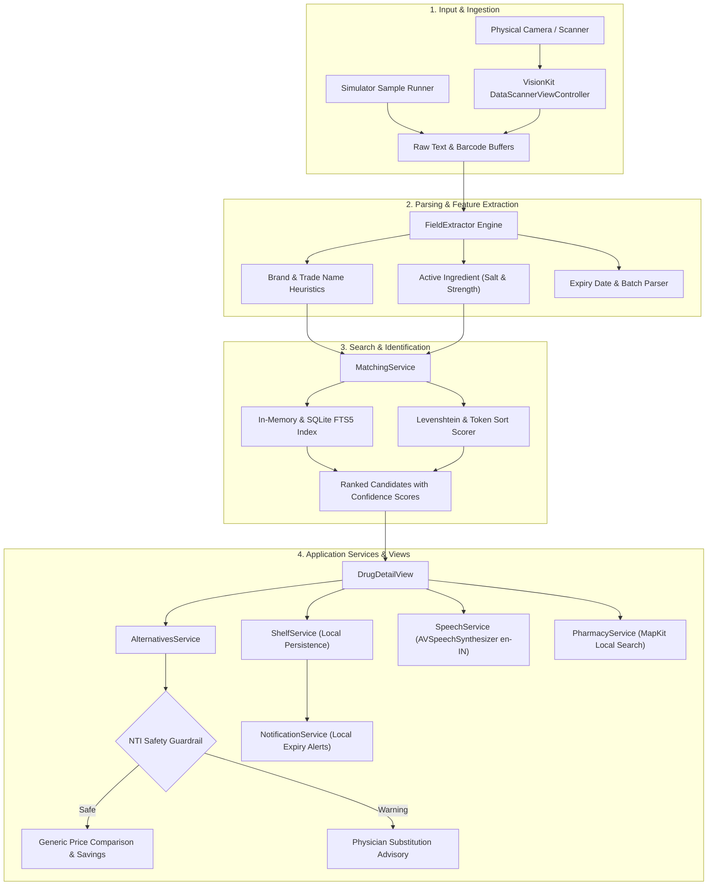

# StripSense

Zero-cloud, privacy-first iOS platform for medicine strip identification, generic drug cost comparison, and offline medicine inventory management.

---

## Executive Overview

India is one of the world's largest consumers and manufacturers of generic pharmaceuticals, yet consumers routinely pay 50% to 90% premiums for branded formulations due to informational asymmetry at the point of purchase. Simultaneously, illegible medicine packaging, complex chemical compositions, and expired household medications present persistent healthcare risks.

StripSense is an on-device iOS application designed to bridge this gap. By utilizing Apple's VisionKit framework, an embedded pharmaceutical knowledge base, and local deterministic matching algorithms, StripSense empowers patients and caregivers to:

- Instantly decipher medicine strips and cartons via optical character recognition and barcode parsing.
- Identify identical active pharmaceutical ingredients (APIs) and compare prices against subsidized Pradhan Mantri Bhartiya Janaushadhi Pariyojana (PMBJP) and National Pharmaceutical Pricing Authority (NPPA) formulations.
- Guard against unsafe substitutions with embedded Narrow Therapeutic Index (NTI) clinical flags.
- Maintain a secure, on-device inventory of home medicines with automated expiry monitoring.
- Locate nearby registered retail pharmacies and Jan Aushadhi Kendras without network profiling or data brokers.

The platform requires no cloud authentication, performs zero remote logging, and operates completely offline.

---

## System Architecture



---

## Technical Capabilities and Architectural Milestones

### 1. Optical Recognition and Data Pipeline
The foundational data layer incorporates standardized pricing schedules from the National Pharmaceutical Pricing Authority (NPPA/NLEM) and the Pradhan Mantri Bhartiya Janaushadhi Pariyojana (PMBJP) product catalog.
- **Embedded Database Architecture**: Standalone data ingestion utility compiles raw pharmaceutical schedules into an indexed SQLite database with Full-Text Search (FTS5) support, pairing brand names, active salts, strengths, and ceiling prices.
- **OCR Evaluation Suite**: Automated testing pipeline measures character error rates (CER), salt identification precision, and field-level extraction recall against standardized test strips before deploying dataset updates.
- **Rule-Based Field Parsing**: Custom regular expressions and contextual grammar extract drug brands, active chemical salts, milligram/microgram dosages, batch numbers, and heterogeneous expiry date formats (e.g., `EXP 12/26`, `EXP. DT. NOV.2025`, `04/2027`).

### 2. Real-Time Vision Processing and Matching Engine
High-throughput camera ingestion engineered directly on Apple Silicon without third-party vision dependencies.
- **VisionKit Live Scanning**: Seamless integration with `DataScannerViewController` allows continuous optical tracking of text and barcode data streams with automatic tap-to-focus and torch controls.
- **Hybrid Matching Architecture**: A two-stage identification engine executes exact matches on scanned barcodes and numeric identifiers, falling back to normalized Levenshtein distance and token-sort similarity scoring across brand and chemical fields.
- **Disambiguation UI**: When packaging is worn, partially occluded, or ambiguous, the application computes confidence percentages and surfaces the top three ranked matches for user confirmation.
- **Direct Geo-Spatial Pharmacy Lookup**: Native `MKLocalSearch` integration pinpoints nearby community pharmacies and Jan Aushadhi outlets within user-defined radii, offering direct calling and directions without transmitting user coordinates to third-party ad networks.

### 3. Therapeutic Equivalency and Medicine Shelf Management
Empowering cost transparency while enforcing clinical guardrails around chemical substitution.
- **Generic Equivalence Algorithm**: Matches scanned drugs against identical active salts and strength concentrations, calculating unit-price differentials and highlighting Jan Aushadhi alternatives.
- **Narrow Therapeutic Index (NTI) Safety Guardrails**: Clinical rules detect high-risk compounds (such as Warfarin, Levothyroxine, Lithium, Digoxin, Carbamazepine, and Phenytoin) where minor bioavailability variances can cause toxicity or treatment failure, surfacing mandatory physician-consultation notices.
- **Personal Medicine Cabinet**: On-device cabinet tracks remaining tablet counts, batch numbers, and storage notes using localized JSON/UserDefaults storage.
- **Predictive Expiry Monitoring**: Native `UserNotifications` engine schedules local background alerts at thirty days, seven days, and on the day of expiry to prevent accidental ingestion of degraded pharmaceuticals.

### 4. Accessibility and Resilient Data Synchronization
Engineered for inclusive usability across diverse age groups and network conditions.
- **Bilingual and Regional Voice Synthesis**: `AVSpeechSynthesizer` configured with localized Indian English (`en-IN`) acoustic profiles delivers high-clarity auditory summaries of drug names, active compositions, and expiry statuses for senior or visually impaired users.
- **Dynamic Type and Ergonomics**: User interface strictly adheres to Apple Accessibility standards, scaling seamlessly across all Dynamic Type text sizes with high-contrast status badges and haptic feedback.
- **Cryptographically Verified Data Sync**: The data synchronization manager periodically checks for manifest updates over HTTPS, verifies binary integrity against SHA-256 hashes, performs an atomic database swap, and automatically rolls back if integrity checks fail.

---

## Project Structure

```
StripSense/
├── Models/
│   ├── Drug.swift                   # Pharmaceutical entity definitions and price schemas
│   ├── ShelfItem.swift              # Personal medicine cabinet storage models
│   ├── Pharmacy.swift               # Geographic dispensary and store metadata
│   ├── ScanModels.swift             # OCR extraction payloads and candidate scoring
│   └── AppSettings.swift            # User configuration and accessibility preferences
├── Services/
│   ├── DrugDatabaseService.swift    # Search interface and in-memory catalogue
│   ├── FieldExtractor.swift         # Heuristic brand, salt, strength, and expiry parser
│   ├── MatchingService.swift        # Token-based and fuzzy similarity matching engine
│   ├── AlternativesService.swift    # Bioequivalent generic finder and NTI safety layer
│   ├── ShelfService.swift           # On-device inventory and persistence layer
│   ├── NotificationService.swift    # Local notification scheduler for expiry tracking
│   ├── PharmacyService.swift        # MapKit dispensary discovery and communication
│   ├── SpeechService.swift          # Localized speech synthesis implementation
│   └── DataUpdateService.swift      # SHA-256 verified over-the-air database updater
├── Utilities/
│   ├── StringSimilarity.swift       # Levenshtein distance and token sort implementations
│   ├── ExpiryDateParser.swift       # Deterministic date parsing across Indian formats
│   └── Formatters.swift             # Currency and measurement formatters
├── Resources/
│   ├── InitialDrugData.swift        # Bundled baseline NPPA and PMBJP data records
│   └── JanAushadhiData.swift        # Sample certified generic distribution centers
├── Views/
│   ├── Home/                        # Dashboard, quick search, and simulator runner
│   ├── Scan/                        # Camera interface, scanner controller, disambiguation
│   ├── Detail/                      # Comprehensive drug card and action center
│   ├── Alternatives/                # Equivalent formulations and cost comparison
│   ├── Pharmacies/                  # MapKit store finder and contact views
│   ├── Shelf/                       # Personal inventory and add/edit forms
│   ├── Settings/                    # Preference toggles, disclaimers, data source details
│   └── Components/                  # Status badges, disclaimer callouts, stat cards
└── scripts/
    ├── build_db.py                  # Generates SQLite index and SHA-256 manifest
    └── evaluate_ocr.py              # Precision and recall test suite for OCR pipelines
```

---

## Technical Stack

| Domain | Technology / Framework | Architectural Role |
|---|---|---|
| User Interface | SwiftUI (iOS 17+) | Declarative, high-performance interface with Dynamic Type |
| Optical Capture | VisionKit (`DataScannerViewController`) | Real-time on-device optical character and barcode recognition |
| Text Processing | Foundation & Regular Expressions | Deterministic parsing of chemical formulations and expiry patterns |
| Search & Indexing | SQLite with FTS5 / In-Memory Swift | Sub-millisecond full-text retrieval across large medicine datasets |
| Equivalence Engine | Custom Algorithmic Matching | Levenshtein distance, token sorting, and NTI safety filtration |
| Geographic Discovery | MapKit (`MKLocalSearch`) | Zero-API-key local pharmacy and Jan Aushadhi store discovery |
| Notifications | UserNotifications Framework | Localized background alerting for approaching product expirations |
| Accessibility | AVFoundation (`AVSpeechSynthesizer`) | Offline Indian English auditory readout of medicine data |
| Data Integrity | CryptoKit / SHA-256 | Cryptographic checksum validation for database updates |

---

## Engineering Deep Dives

### Multi-Stage Matching Architecture
Raw optical character recognition streams from medicine packaging are inherently prone to noise caused by foil reflection, embossing, curvature, and typography variations. The matching pipeline addresses this through a staged filter:

1. **Exact Identifier Lookups**: Scanned numeric strings are checked against National Drug Codes, barcodes, and registered packaging IDs.
2. **Deterministic Token Sanitization**: Noise words (`Tablet`, `Cap`, `IP`, `BP`, `USP`, `Mfg`, `Exp`) are isolated from active chemical names.
3. **Token Sort Similarity**: Active ingredients often list components in arbitrary order (e.g., `Paracetamol + Caffeine` vs `Caffeine + Paracetamol`). The tokenizer sorts and compares word vectors independently of presentation order.
4. **Normalized Levenshtein Distance**: Typographical errors in OCR output are reconciled against registered brand and salt dictionaries. Matches exceeding a configurable threshold are ranked into confidence percentiles.

### Narrow Therapeutic Index Safety Guardrails
Generic substitution is not clinically appropriate for all drug classes. Narrow Therapeutic Index (NTI) drugs exhibit a narrow margin between effective doses and fatal or adverse concentrations.

The alternative recommendation engine actively checks candidate salts against an embedded NTI classification registry:
- Formulations containing compounds such as Warfarin, Digoxin, Theophylline, Carbamazepine, Lithium, or Levothyroxine are restricted from direct generic swap recommendations.
- The interface automatically replaces generic cost savings badges with an elevated medical notice advising that brand-to-brand substitution for the identified drug must be supervised by a prescribing physician.

---

## Building and Running

### Prerequisites
- macOS Sonoma or later
- Xcode 15.0 or later
- Physical iOS device running iOS 17.0+ (recommended for live camera capture) or iOS Simulator

### Build Steps
1. Clone the repository to your local machine:
   ```bash
   git clone https://github.com/Siddhantshukla1657/StripSense.git
   ```
2. Open `StripSense.xcodeproj` in Xcode.
3. Select your target device or simulator.
4. Build and run the project (`Cmd + R`).

### Simulator Demonstration Mode
When running inside the iOS Simulator where camera hardware is unavailable, the application automatically mounts a **Demo & Simulator Samples** panel on the Home view. Selecting any test strip immediately loads pre-processed camera buffers into the extraction and matching pipeline, enabling complete verification of the identification, generic comparison, and shelf flows.

---

## Offline Tooling and Benchmarking

The `scripts/` directory provides Python utilities for database generation and OCR evaluation.

### Compiling the Drug Database
To regenerate the embedded pharmaceutical index and calculate a new cryptographic manifest:
```bash
cd StripSense/scripts
python build_db.py
```
This processes raw national price schedules into `drugs.sqlite` with an accompanying `manifest.json` containing the SHA-256 digest and version tag.

### Running the OCR Evaluation Suite
To benchmark parsing accuracy and character-level error rates against ground-truth sample strips:
```bash
cd StripSense/scripts
python evaluate_ocr.py
```
The script outputs field-by-field accuracy statistics (Brand, Active Salt, Strength, Expiry Date, Batch Number) and highlights edge-case discrepancies.

---

## Data Privacy and Security Architecture

StripSense follows a strict local-first privacy standard:

- **Local Image Processing**: Camera frames and OCR buffers are processed directly within the device memory space and are never saved to disk or transmitted across networks.
- **Zero Telemetry and Analytics**: The application contains no analytics tracking SDKs, crash logging trackers, or behavioral profiling tools.
- **Isolated Local Storage**: User medicine inventory and notification preferences are saved within the application's local sandbox and are not synchronized to third-party endpoints.
- **Ephemeral Location Queries**: Location coordinates used to discover nearby pharmacies via MapKit are handled entirely through Apple's native APIs and are never stored or logged by StripSense.

---

## Medical Advisory

StripSense is developed strictly as an informational and educational utility. It does not provide medical advice, diagnosis, treatment plans, or prescription recommendations. Chemical salt equivalency and cost comparisons are generated from published government datasets and should always be verified with a qualified physician or licensed pharmacist prior to making any clinical decisions or substituting medications.
