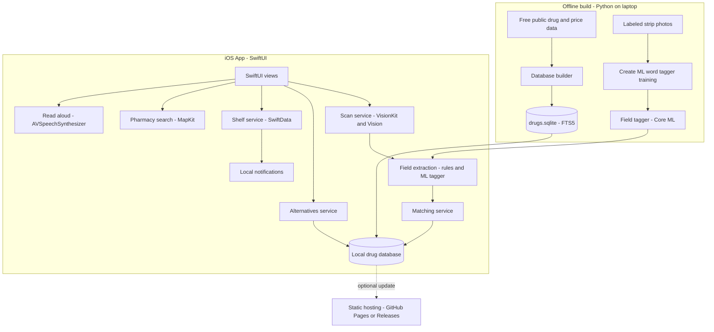
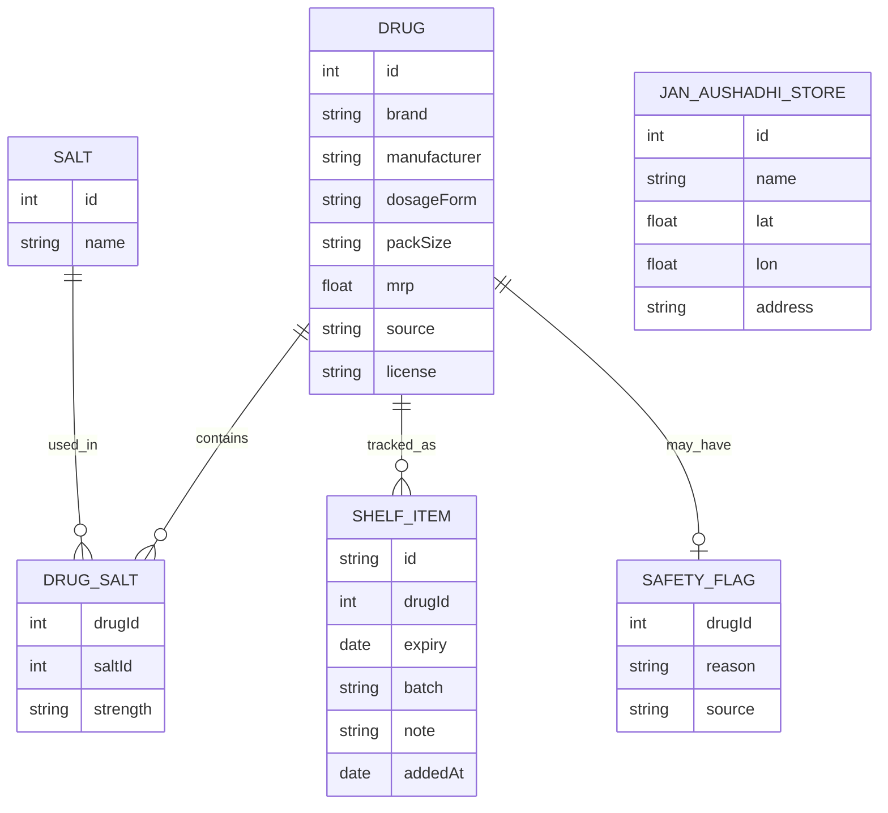

# StripSense — Architecture

> **Status:** Draft | **Last updated:** 2026-10-10

## 1. System Overview
StripSense is a fully on-device iOS app. A bundled SQLite drug database is built offline by a Python script from free public sources. At runtime the app scans a strip with Apple's VisionKit and Vision frameworks, extracts fields with rules (plus an optional Create ML tagger), fuzzy-matches against the database, and shows details, alternatives and a personal shelf. Nearby pharmacies come from native MapKit search. There is no custom backend and no accounts. The only optional network use is MapKit itself and a free static-hosted data manifest for database updates.

## 2. Architecture Diagram

## 3. Tech Stack
| Layer | Technology | Rationale |
|---|---|---|
| Frontend | SwiftUI (iOS 17+) | Native, free, accessible by default |
| Scanning | VisionKit DataScanner, Vision text and barcode recognition | On-device OCR, no cost, no network |
| Parsing and ML | Swift rules and regex; Create ML word tagger to Core ML | Rules first; ML only improves accuracy |
| Database | SQLite with FTS5 (GRDB or SQLite.swift) | Fast offline fuzzy search over a bundled file |
| User data | SwiftData | Simple local persistence for the shelf and settings |
| Maps | MapKit (native local search) | No API key and no server |
| Notifications | UserNotifications (local) | Free and private |
| Speech | AVSpeechSynthesizer | Built in |
| Build tooling | Python 3.11+ (pandas, sqlite3) | Reproducible data builds |
| Hosting (optional) | GitHub Pages or Releases | Free static files for data updates |
| Auth and backend | None | Per the project constraints |

## 4. Component Breakdown

### 4.1 Scan Service
- **Responsibility:** capture frames, run text and barcode recognition, vote across frames, return text with confidence.
- **Interfaces:** `scan() async -> ScanResult`, `recognize(photo:) async -> ScanResult`
- **Depends on:** VisionKit, Vision, camera permission.

### 4.2 Field Extractor
- **Responsibility:** convert text into structured fields (brand, salt, strength, expiry, batch) using rules and the optional ML tagger.
- **Interfaces:** `extract(from: ScanResult) -> ExtractedFields`
- **Depends on:** Core ML tagger (optional).

### 4.3 Matching Service
- **Responsibility:** produce up to three ranked candidates using FTS and fuzzy scoring; support exact barcode lookup.
- **Interfaces:** `candidates(for: ExtractedFields) -> [Candidate]`, `search(query:) -> [Drug]`
- **Depends on:** Drug Database.

### 4.4 Drug Database
- **Responsibility:** serve drug records, salts, prices and sources; expose version and update status.
- **Interfaces:** `drug(id:)`, `alternatives(of:)`, `version()`
- **Depends on:** the bundled SQLite file.

### 4.5 Alternatives Service
- **Responsibility:** list identical salt, strength and form matches; apply the safety flag list.
- **Interfaces:** `alternatives(for: Drug) -> AlternativesResult`
- **Depends on:** Drug Database.

### 4.6 Shelf Service
- **Responsibility:** store shelf items, compute expiry status, schedule and cancel reminders.
- **Interfaces:** `add(drug:, expiry:)`, `remove(id:)`, `items() -> [ShelfItem]`
- **Depends on:** SwiftData, UserNotifications.

### 4.7 Pharmacy Search
- **Responsibility:** find nearby pharmacies and build call or message actions.
- **Interfaces:** `nearby(coordinate:) async -> [Pharmacy]`, `messageDraft(for: Drug, pharmacy:)`
- **Depends on:** MapKit, location permission.

### 4.8 Data Updater
- **Responsibility:** check the manifest, download, verify and swap the database; support rollback.
- **Interfaces:** `checkForUpdate() async`, `install(update:)`
- **Depends on:** static hosting (optional), file system.

### 4.9 Offline Builders
- **Responsibility:** build the database and train the tagger.
- **Interfaces:** CLI: `build_db --sources ...`, `train_tagger --data ...`
- **Depends on:** public datasets, labeled photos.

## 5. Data Model

*Pharmacies come from MapKit at runtime and are not stored. Scans are not stored unless the user adds an item to the shelf.*

## 6. API Design
The app has no API of its own and calls no paid service.

| Method | Endpoint | Purpose | Auth required |
|---|---|---|---|
| Local | MapKit local search (pharmacy points of interest) | Nearby pharmacies | No |
| GET | `manifest.json` on static hosting (optional) | Latest database version and checksum | No |
| GET | `drugs-vN.sqlite` on static hosting (optional) | Updated drug database | No |

## 7. Infrastructure & Deployment
- **Environments:** local development and testing on the developer's own iPhone.
- **Distribution (free path):** install via Xcode using a free Apple ID (re-sign about every 7 days); publish source on GitHub with a demo video.
- **Distribution (paid, optional):** Apple Developer Program for TestFlight and the App Store.
- **CI (free):** GitHub Actions for Python tests and data checks; Swift tests run locally in Xcode.
- **Data releases:** versioned SQLite files and a manifest on GitHub Pages or Releases.

## 8. Security Considerations
- All scans and shelf data stay on device; no accounts, no analytics on medicine data.
- Database updates are verified by checksum and schema version before installing, with rollback.
- HTTPS only for the optional update fetch.
- Respect data source licenses; show attribution and source per record.
- Medical disclaimer on every information screen; no dosing or interaction content.

## 9. Scalability & Performance
- **Load:** single-user and on device; no server scaling.
- **Bottlenecks:** OCR quality and fuzzy-search speed.
- **Strategies:** FTS5 index with candidate prefiltering before fuzzy scoring; multi-frame voting to improve OCR; keep the database to a curated size; run Vision off the main thread; target candidates in under 3 seconds.

## 10. Key Technical Decisions & Tradeoffs
| Decision | Alternatives considered | Why this choice |
|---|---|---|
| On-device Vision OCR | Cloud OCR APIs | Free, private, offline |
| Bundled SQLite database | Remote API | No backend; fast offline search |
| Rules first, ML tagger later | ML from the start | Rules are quick to build and explainable; ML adds a measured lift |
| Confirm top-3 candidates | Auto-accept the best match | Prevents confident wrong answers |
| Native MapKit for pharmacies | Google Places | Free, no key, no server |
| Static hosting for updates | Firebase or own API | Free; no backend |
| No crowd availability | Shared database | Needs a backend; deferred |

## 11. Open Technical Questions
- [ ] Which free sources give the best coverage with usable licenses?
- [ ] Which SQLite wrapper (GRDB or SQLite.swift) fits best?
- [ ] How reliable is MapKit pharmacy search and its usage limits for a small app?
- [ ] How many labeled strips are needed for a useful tagger?
- [ ] Can the free Apple ID provisioning limits support ongoing testing?
