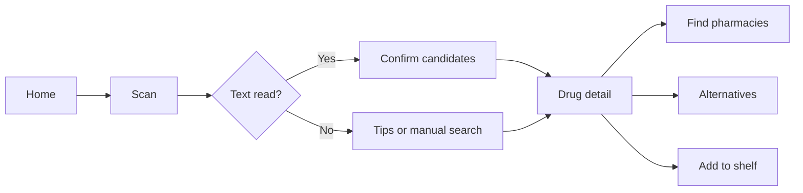
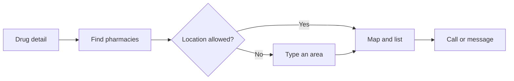
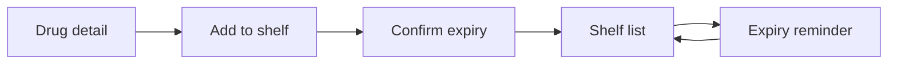

# StripSense — Design Document

> **Status:** Draft | **Last updated:** 2026-10-10

## 1. Design Principles
- **Readable first:** large type, high contrast, and few words, because many users are elderly or stressed.
- **Confirm, never assume:** the app suggests; the user confirms. No silent guesses.
- **Calm and trustworthy:** clear, restrained visuals; no alarming effects except for real expiry warnings.
- **Private by default:** no accounts, no sign-in screens, and a visible "stays on your phone" message.
- **Never color alone:** status is always paired with an icon and text.

## 2. User Flows

### 2.1 Scan a strip

The user taps Scan, points the camera at the strip, and sees up to three candidates. They confirm one (or choose "None of these"), then land on the detail screen with next actions.

### 2.2 Find a pharmacy

### 2.3 My Medicines shelf

The shelf sorts by soonest expiry, with clear ok, expiring-soon and expired states.

## 3. Key Screens / Views

### 3.1 Home
- **Purpose:** start point with the main actions.
- **Key elements:** large Scan button, search field, shelf shortcut with count of expiring items, privacy note.
- **States:** first launch — short intro; populated — shows the expiring badge.

### 3.2 Scan
- **Purpose:** capture the strip.
- **Key elements:** live camera with a guide frame; tip text (reduce glare, hold steady); torch toggle; photo import button.
- **States:** searching — subtle progress; low confidence — tip appears; permission denied — explanation with import and search buttons.

### 3.3 Confirm Candidates
- **Purpose:** let the user pick the correct medicine.
- **Key elements:** up to three cards (brand, salt, strength, form); highlighted strength; "None of these" button.
- **States:** no match — message and manual search; single strong match — still requires a tap.

### 3.4 Drug Detail
- **Purpose:** show the confirmed medicine.
- **Key elements:** brand, salt and strength, dosage form, pack size, price and source, scanned expiry with status, action buttons (Find pharmacies, Alternatives, Add to shelf, Read aloud), disclaimer.
- **States:** expired — prominent warning; missing price — "price not available."

### 3.5 Alternatives
- **Purpose:** compare same-salt options.
- **Key elements:** list sorted by price with savings per pack; disclaimer banner.
- **States:** flagged drug — replaces the list with "Do not switch without asking your doctor"; none found — message.

### 3.6 Pharmacies
- **Purpose:** find and contact nearby pharmacies.
- **Key elements:** map with pins; list with distance; Call and Message buttons; optional Jan Aushadhi markers (distinct icon and label).
- **States:** location denied — area text field; offline — message explaining the map needs a connection.

### 3.7 My Medicines
- **Purpose:** track what's at home.
- **Key elements:** list with expiry status chips (icon plus text); add and edit; swipe to remove.
- **States:** empty — prompt to scan the first strip.

### 3.8 Settings and About
- **Purpose:** preferences and transparency.
- **Key elements:** large text and read-aloud toggles, reminder timing, data version and update button, data sources and licenses, disclaimer.

## 4. Component Library / Style Guide
| Token | Value | Usage |
|---|---|---|
| Primary | #2563EB (blue) | Primary buttons and links |
| OK | #15803D (green) | OK status (with check icon) |
| Warning | #B45309 (amber) | Expiring soon (with clock icon) |
| Danger | #B91C1C (red) | Expired and safety flags (with alert icon) |
| Surface (light) | #FFFFFF | Cards and sheets |
| Surface (dark) | #1C1C1E | Cards in dark mode |
| Text | System label colors | All body text |
| Font — heading | SF Pro Rounded, Semibold | Titles |
| Font — body | SF Pro, Regular | Body, Dynamic Type enabled |
| Minimum tap target | 48 pt | Buttons and rows |
| Spacing scale | 4, 8, 12, 16, 24, 32 pt | Layout |
| Corner radius | 16 pt | Cards |

*Contrast of all status colors to be verified in light and dark mode.*

## 5. Interaction Patterns
- Scanning gives a light haptic when text is locked in; candidates appear with a short fade.
- Confirmation is always an explicit tap; nothing auto-advances.
- Destructive actions (remove from shelf) use swipe with undo.
- Disclaimers are visible inline, not hidden behind links.
- Reminders open the shelf item directly.

## 6. Accessibility
- Target WCAG AA contrast and verify overlay text on map backgrounds.
- Dynamic Type through accessibility sizes; layouts reflow.
- VoiceOver labels on every control; candidate cards read brand, salt, strength and form together.
- Read-aloud option for drug details.
- Status never conveyed by color alone.
- Reduce Motion disables fades and animated transitions.

## 7. Responsive / Platform Behavior
- iPhone first, portrait; layouts adapt to small and large phones.
- iPad runs as a scaled iPhone layout for now.
- Light and dark mode supported.

## 8. Edge Cases & Error States
- Edge case: no text recognized → handled by: tips, photo import, and manual search.
- Edge case: strength differs between candidates → handled by: strength highlighted on each card.
- Edge case: expired strip scanned → handled by: red expired banner and a prompt not to add it to the shelf without confirmation.
- Error state: camera denied → handled by: explanation with photo import and search.
- Error state: location denied → handled by: type-an-area input.
- Error state: offline map → handled by: message and retry; the rest of the app still works.
- Error state: data update failed verification → handled by: keep the current database and show a short message.

## 9. Open Design Questions
- [ ] Should the confirmation step show the matched strip text next to each candidate to help the user decide?
- [ ] How prominent should the disclaimer be on the detail screen without feeling noisy?
- [ ] Is a simplified "large mode" a separate layout or just larger Dynamic Type?
- [ ] Which regional languages, if any, should the first release support?
